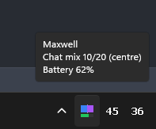

# audeze-maxwell-tray

Show the Game/Chat Mix dial position and battery level of an **Audeze Maxwell 2** (USB
dongle) in the Windows tray, without the Audeze app.



> This project is not affiliated with, endorsed by or supported by Audeze. "Audeze" and
> "Maxwell" are trademarks of their owner.

## Tested with

- Audeze Maxwell 2 with its **USB-C wireless dongle** (`VID_3329 & PID_4B28`), on Windows 11
- Windows PowerShell 5.1 and PowerShell 7

Only the dongle has been tested. The scripts look for the dongle only, so they do not find
the headset when it is connected directly with a USB-C cable (`PID_4B2E`). Other Audeze
headsets and the original Maxwell have not been tested.

## Getting started

1. Clone the repository, or download it as a ZIP and extract it.
2. If you downloaded a ZIP, unblock the files. Otherwise PowerShell can refuse to run them:

   ```powershell
   Get-ChildItem -Path . | Unblock-File
   ```

3. Start the tray icon from a PowerShell window in the folder:

   ```powershell
   .\chatmix-tray.ps1               # starts detached in the tray
   .\chatmix-tray.ps1 -Foreground   # stays attached to the console, for debugging
   ```

   If PowerShell says that running scripts is disabled, use this command:

   ```powershell
   powershell -ExecutionPolicy Bypass -File .\chatmix-tray.ps1
   ```

New tray icons can go into the hidden-icons area (`^`). Drag the icon onto the taskbar to keep
it next to the clock.

## Run at startup

**From the tray icon (recommended):** right-click the icon and select **Start with Windows**.
This adds the shortcut `Maxwell chat mix.lnk` to your Startup folder. The shortcut starts the
tray icon with Windows PowerShell and a hidden window when you sign in. To stop this, select
**Start with Windows** again.

**Manually:** if you prefer to make the shortcut yourself:

1. Press `Win+R`, type `shell:startup` and press Enter. The Startup folder opens.
2. Right-click in the folder and select **New > Shortcut**.
3. For the location, enter this command. Change the path to where you put the files:

   ```
   powershell.exe -NoProfile -ExecutionPolicy Bypass -STA -WindowStyle Hidden -File "C:\path\to\audeze-maxwell-tray\chatmix-tray.ps1" -Foreground
   ```

4. Give the shortcut a name, for example `Maxwell chat mix`, and select **Finish**.
5. Optional: open the shortcut's **Properties** and set **Run** to **Minimized**. This keeps a
   console window from showing at sign-in.

Use `-Foreground` in the shortcut. Without it, the script starts a second, hidden copy of
itself and exits.

**If you move the folder,** the shortcut stops working. Select **Start with Windows** twice
(off, then on), or edit the path in the shortcut.

## Tray icon

- **Top bar:** the mix. Blue (game) fills from the left and purple (chat) from the right. The
  boundary is the dial position, and the small notches mark the centre. Grey = no headset.
- **Bottom strip:** battery. Green, then amber at 30 % or less, then red at 15 % or less.
- **Low battery notification:** a Windows notification shows once when the battery drops to
  15 % (`-LowBattery` changes the limit). It is on by default. Windows notifications must be
  on (**Settings > System > Notifications**), or Windows does not show it.
- **Tooltip:** exact values, e.g. `Chat mix 14/20 (chat +4)` / `Battery 63%`.
- **Right-click menu:** show the mix as a number, turn the low battery notification on or off,
  refresh battery, *Start with Windows* (adds a shortcut to the Startup folder), exit. The
  notification setting is kept in `HKCU\Software\audeze-maxwell-tray`.

The mix is polled every 250 ms (`-IntervalMs`) and the battery every 60 s. Only one instance
runs at a time. Polling pauses while the Audeze app runs, and starts again when the app closes.

## Command line

```powershell
.\chatmix.ps1                          # read once: value=10 battery=63% raw=05-5B-...
.\chatmix.ps1 -Seconds 30 -IntervalMs 100   # watch the mix live, print on change
```

Both scripts load the HID code from `Maxwell.cs`. They work in Windows PowerShell 5.1 and
PowerShell 7.

Close the Audeze app and exit the tray icon before you use `chatmix.ps1`. All three poll the
same HID interface. When two of them poll at the same time, they steal each other's responses.
(The tray icon pauses by itself while the Audeze app runs. `chatmix.ps1` does not.)

**Values:** `0..20`, one per detent, **10 = centre**, **0 = full game**, **20 = full chat**.
`value=-1` with an empty `raw=` means that the headset did not answer in about 400 ms. The
headset can be off or out of range, or another program can be polling the interface.

## Use Maxwell.cs in your own script

`Maxwell.cs` has no dependencies. Load it with `Add-Type`:

```powershell
Add-Type -Path .\Maxwell.cs

# Read once. FindPath() returns $null when the dongle is not plugged in.
$dev = New-Object Maxwell ([Maxwell]::FindPath())
try { $dev.ReadChatMix(); $dev.ReadBattery() } finally { $dev.Dispose() }   # -1 = no answer

# Or poll on a background thread, as the tray icon does.
$poller = New-Object MaxwellPoller 250   # mix interval in ms. The battery is read every 60 s.
$poller.Start()
$poller.State      # ChatMix, Battery (-1 = unknown) and Status ("" when the headset answers)
$poller.Stop()
```

The poller replaces `State` with a new object only when a value changes. Thus a reference
compare is enough to find out if something changed.

## TODO

- [x] Tray icon showing the current position
- [x] Battery level
- [x] Confirm which end is game: 0 = game (the headset beeps when the dial reaches the game end)
- [ ] Charging state: the app has no read for it (no `readCharging*` in `MaxwellTransport`)

## Protocol notes

Found by disassembling `Audeze.exe` 1.2.48 (MinGW build, symbols intact):
`Devices::MaxwellTransport::readGameChatMix`, `readCmdAndValidate`, `readCommand`,
`Platform::MaxwellHidApiClient::{write,read}`.

### Device

- Dongle: `VID_3329 & PID_4B28` (headset over USB-C cable is `PID_4B2E`)
- Airoha chip, speaks the Airoha **RACE** protocol over HID
- Interface `MI_05`, collection `COL02`: vendor usage page `0xFF13`, 62-byte in/out reports
- `COL01` = consumer control (volume wheel sends standard Volume Up/Down: `0C-01` / `0C-02`)

### The dial is never pushed

Turning the chat-mix dial produces **no** HID input reports and does **not** change the
Windows endpoint volumes of the "Game" / "Chat" devices — mixing happens in the headset.
The position must be **polled**.

### Request (output report, `hid_write` / `WriteFile`, 62 bytes, zero-padded)

```
06 08 80 05 5A 04 00 83 2C 0B 00
│  │  │  └─────────────────────── RACE packet (8 bytes)
│  │  └── 0x80 when talking via the dongle (isOpenedDongle << 7), 0x00 when wired
│  └───── RACE packet length
└──────── report ID 6
```

RACE packet: `05` (channel) `5A` (command, expects response) `04 00` (length LE)
`83 2C` (command id 0x2C83) `0B 00` (parameter 0x0B = game/chat mix).

### Response (`HidD_GetInputReport` / GET_REPORT, report ID 7, 62 bytes)

Poll every ~10 ms after the write. Report layout: `07 <n> <?> <n data bytes>`; `n <= 0x3B`,
data starts at offset 3. Concatenate data into a stream until a full RACE packet
(`length + 4` bytes) is present.

```
05 5B 06 00 83 2C 00 0B 00 0E
      └len┘ └id─┘ │  └par┘ └── value (0x0E = 14)
                  └── status 0 = OK
```

Valid if `[0]=05 [1]=5B [4]=83 [5]=2C` and the status `[6]` is 0. The value is byte `[9]`.

The responses are fetched with GET_REPORT, so they are **not** broadcast to other open
handles — passive sniffing with `ReadFile` sees nothing.

### Battery (`readBatteryLevel`, Audeze.exe 1.2.48)

Request: `06 07 80 05 5A 03 00 D6 0C 00`. That is RACE command id `0x0CD6`, parameter `00`.

The headset replies with **two** packets. The app waits for both:

```
05 5B 03 00 D6 0C 00                 ack: [6] = status, 0 = OK
05 5D 05 00 D6 0C 00 00 3F           indication (type 5D): [8] = level (0x3F = 63 %)
```

If the ack status is not 0, `Maxwell.cs` stops and returns -1.

### Other packets in the stream

The reply stream also carries unrelated packets, for example firmware debug text
(`05 5D .. 92 0F "LE connected, handle 0x0001\n"`) and `05 5C` packets. `Maxwell.cs`
resyncs on `05` followed by a type byte `5A`..`5D`, and skips packets that do not match.

### Related (not yet tested)

The same transport has `readSidetoneLevel`, `readMicMute`, `readAncMode`, `readPoweredOn`,
`readAutoPowerOff`, etc. Disassemble them the same way (capstone + the COFF symbols that the
MinGW build keeps) to get their command bytes.

## License

MIT. See [LICENSE](LICENSE).
